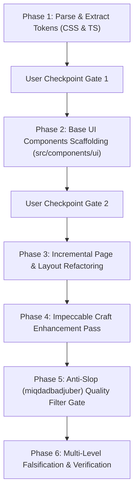

# Design System Adopter & Orchestrator

This skill guides AI agents through the complete, uncompressed, and phased adoption of any `DESIGN.md` (or `*.design.md`) specification into an existing or new web codebase.

It combines:
1. **The System Design Specification (`DESIGN.md`):** The authoritative visual truth (colors, typography, radii, spacing, component definitions).
2. **Impeccable (Design Director):** Enforces high craft, browser surface theming, tactile micro-interactions, and visual restraint.
3. **Anti-Slop by miqdadbadjuber (Quality Filter Gate):** Enforces 38 anti-slop rules (Hard Gates, Human/A11y Gates, 5 lifecycle states, and zero mobile overflow).

---

## The Core Operational Invariants

1. **The Brief Wins Unconditionally:** Only use tokens defined in the input `DESIGN.md`. Never invent ad-hoc colors, arbitrary radii, or unapproved styling.
2. **Phased Execution with Checkpoint Gates:** Never do a "big-bang" rewrite. Execute Phase 1 first -> stop and confirm with user -> execute Phase 2 -> stop and confirm -> execute Phase 3 -> execute Enhancement & Anti-Slop gates.
3. **Tailwind CSS v4 `@theme` vs `:root` Invariant (CRITICAL):**
   * In Tailwind CSS v4 (`@tailwindcss/vite`), placing `--spacing-sm: 8px;`, `--spacing-md: 12px;`, `--spacing-lg: 16px;`, `--spacing-xl: 24px;` directly inside `@theme` causes Tailwind to bind container width utilities (`max-w-sm`, `max-w-md`, `max-w-lg`, `max-w-xl`) to `--spacing-*` instead of `--container-*`.
   * **Result if violated:** `.max-w-sm` collapses into `8px;`, `.max-w-md` into `12px;`, and `.max-w-lg` into `16px;`, crushing cards and modals into narrow unreadable vertical slivers.
   * **The Immutable Rule:** Colors, font families, and radii belong in `@theme`. All `--spacing-*` tokens MUST be declared in `:root` outside `@theme`.
4. **Anti-Slop Gate Priority:** Impeccable directs the aesthetic; Anti-slop filters out generic AI tropes (no unearned kickers/eyebrows, no nested cards / border-in-border, no generic gradients, WCAG AA contrast, and zero mobile horizontal overflow).

---

## Detailed Step-by-Step Workflow



---

### Phase 1: Parse & Extract Tokens (Step 1)

1. **Read and analyze the input `DESIGN.md`:**
   * Extract all color tokens (primary, surface, canvas, ink, hairlines, semantic terminal/state colors).
   * Extract typography scales (display, heading, body, caption, code, button font families, sizes, weights, line heights).
   * Extract corner radii (e.g. `none: 0px`, `sm: 6px`, `md: 8px`, `lg: 12px`, `full: 9999px`).
   * Extract spacing scales (e.g. `xxs: 2px`, `xs: 4px`, `sm: 8px`, `md: 12px`, `lg: 16px`, `xl: 24px`, `xxl: 32px`, `section: 88px`).
2. **Implement in CSS (`src/styles/global.css`):**
   * Declare colors, font families, and radii inside `@theme`.
   * **MANDATORY:** Declare all `--spacing-*` tokens in `:root` (never inside `@theme`).
   * Declare typography utilities using `@utility <name>` with explicit font-family, font-size, font-weight, line-height, and letter-spacing.
3. **Generate TypeScript Definitions (`src/lib/design-tokens.ts`):**
   * Export typed constants for `DESIGN_COLORS`, `DESIGN_TYPOGRAPHY`, `DESIGN_RADII`, `DESIGN_SPACING` for programmatic runtime access.
4. **Validate Compilation:**
   * Run a compiler test or build check to ensure container utilities (`max-w-sm`, `max-w-md`, `max-w-lg`) resolve to `var(--container-*)` (e.g. 384px, 448px, 512px) and NOT spacing pixels.
5. **Checkpoint Gate:** Stop and present the extracted token mapping to the user before proceeding to Phase 2.

---

### Phase 2: Base UI Components Scaffolding (Step 2)

Create or update atomic base components inside `src/components/ui/` adhering 100% to the component definitions in `DESIGN.md`:

1. **Buttons (`Button.tsx`):**
   * Varian: `primary`, `secondary`, `pill-on-dark`, `disabled`.
   * Shape: Fully rounded pill (`rounded-full`, 9999px).
   * States: Default, hover, active (`active:scale-[0.99]`), focus-visible (`focus-visible:ring-2 focus-visible:ring-focus-ring`), and disabled (neutral surface `bg-surface-soft`, `opacity-65`, readable text, never saturated accent).
2. **Inputs (`Input.tsx`):**
   * `TextInput` (h-10, px-4, rounded-full, border-hairline, placeholder:text-body/70).
   * `SearchPill` (h-9, px-4, rounded-full, bg-surface-soft, focus:bg-canvas).
3. **Terminal & Badges (`Terminal.tsx`):**
   * `TerminalTrafficLights` (red `#ff5f56`, yellow `#ffbd2e`, green `#27c93f` dots).
   * `InstallSnippet` (curl/bot link pill, rounded-full, select-all code, copy action).
   * `CommandTag` (rounded-full font-mono tag).
   * `TerminalCard` (rounded-lg, traffic lights header, horizontal scroll).
4. **Cards (`Card.tsx`):**
   * `PricingCard` (flat paper-white canvas, rounded-lg, border-hairline, p-8).
   * `PricingCardDark` (inverted dark surface `#171717`, text-on-dark, rounded-lg, p-8).
   * `CtaStripDark` (inverted dark strip, rounded-lg).
5. **Primitives (`Primitives.tsx`):**
   * `FeatureBullet` (supports light and dark surfaces, check icon).
   * `FaqRow` (flat accordion row, border-b hairline, +/- toggle, zero nested card boxes).
   * `LinkInline` and `LinkMute` (underline offset 3px).
6. **Navigation & Shell (`Navigation.tsx`):**
   * `PrimaryNav` (h-14, sticky top-0, border-b hairline, bg-canvas).
   * `FooterSection` (py-8, border-t hairline, text-body text-caption-sm).
7. **Export Barrel (`index.ts`):** Export all components cleanly.
8. **Checkpoint Gate:** Run `npm run typecheck` and confirm with user before touching application pages.

---

### Phase 3: Incremental Page & Layout Refactoring (Step 3)

Refactor pages step-by-step from outside in:

1. **Root Layout (`Layout.astro` / `layout.tsx`):**
   * Reset background and text to canvas tokens (`bg-canvas text-ink`).
   * Remove old dark-mode toggles, flash-of-theme scripts, and foreign border classes.
2. **Landing Page (`LandingPage.tsx` / `index.astro`):**
   * Hero: Center-aligned 36px SF Pro Rounded headline (`text-display-xl`), subheadline, and signature install snippet pill.
   * Visual Showcase: Terminal card displaying authentic CLI sessions (`> prompt`), side-by-side with structured card output.
   * Pricing Section: Standard flat card + single inverted dark card (`#171717`).
   * FAQ: Clean row dividers without card nesting.
3. **Authentication & Onboarding (`login.astro` / `Login.tsx`):**
   * Center card with `max-w-sm` (verifying width is ~384px), pill social button, dev login bypass, border-hairline.
4. **Application Workspace / Dashboard:**
   * Sidebar: Permanent desktop sidebar + mobile slide-over drawer, nav pill items.
   * Content Timeline / Lists: Minimal cards, monospace category tags, copy buttons.
   * Detail / Modals (`EditModal`, `UpgradeModal`): `max-w-lg` (~512px), backdrop blur, clean inputs, zero nested cards.
5. **Admin / Data Console:**
   * Metric summary cards, tabular data tables with neutral hairline borders.

---

### Phase 4: Impeccable Craft Enhancement Pass

1. **Synchronize System Context:**
   * Ensure `DESIGN.md` and `PRODUCT.md` exist at the project root.
   * Run launcher: `.gemini/skills/impeccable/scripts/impeccable.cmd context` (or `impeccable context`).
   * Confirm platform `web` and target design tokens are locked.
2. **Apply Browser Surface Craft Rules (`src/styles/global.css`):**
   * **Selection Theme:**
     ```css
     ::selection {
       background-color: var(--color-primary);
       color: var(--color-on-primary);
     }
     ```
   * **Caret Color:**
     ```css
     input, textarea {
       caret-color: var(--color-ink);
     }
     ```
   * **Custom Hairline Scrollbar:**
     ```css
     * {
       scrollbar-width: thin;
       scrollbar-color: var(--color-hairline-strong) transparent;
     }
     ::-webkit-scrollbar {
       width: 6px;
       height: 6px;
     }
     ::-webkit-scrollbar-thumb {
       background-color: var(--color-hairline-strong);
       border-radius: 9999px;
     }
     ```
   * **Focus Rings:**
     ```css
     :focus-visible {
       outline: 2px solid var(--color-focus-ring);
       outline-offset: 2px;
     }
     ```
3. **Apply Numeric Stability (`tabular-nums`):**
   * Add `tabular-nums` (`font-variant-numeric: tabular-nums`) to all prices, counters, timestamps, badge metrics, and table figures to eliminate numeral width jitter.
4. **Tactile Micro-interactions:**
   * Add `active:scale-[0.99] transition-all duration-150` to all primary buttons and interactive pill elements.

---

### Phase 5: Anti-Slop (miqdadbadjuber) Quality Filter Gate

Apply the 38-rule anti-slop audit filter to reject generic AI tropes:

1. **Hard Gates (Banned AI Tropes):**
   * **No Eyebrows / Kickers:** Ban small pill badges directly above main headings (`<CommandTag>{badge}</CommandTag> <h1>...</h1>`). Let the heading speak with its own typographic scale.
   * **No Nested Cards (Border-in-Border):** Ban placing bordered cards inside another bordered card. Replace with clean recessed surfaces (`bg-surface-soft` without border) or authentic CLI prompt lines (`> command`).
   * **No Generic AI Pyrotechnics:** Ban purple/indigo gradients, floating glow orbs, and generic sparkles standing in for substance.
2. **Human & Accessibility Gates:**
   * **WCAG AA Contrast:** Body and placeholder text must have `>= 4.5:1` contrast against canvas. (e.g. Set placeholder color to `--color-body` `#737373` instead of pale `#a3a3a3`).
   * **Disabled Controls Contrast:** Disabled buttons must drop to neutral surface tokens (`bg-surface-soft`) with readable text (`opacity-65`), never retaining saturated accent backgrounds.
   * **5 Mandatory Data Lifecycle States:** Every data component must explicitly support:
     1. Loading state (spinners/skeletons)
     2. Empty state (helpful illustration/text + action CTA)
     3. Error state (actionable recovery message)
     4. Success state (toast/confirmation)
     5. Disabled state (accessible contrast)
   * **Zero Mobile Horizontal Overflow:** All code blocks, URLs, and containers must use `break-words`, `break-all`, `min-w-0`, or `overflow-x-auto`.
3. **Copywriting Sanity:**
   * Strip robotic corporate AI buzzwords ("revolutionary", "supercharge", "unleash", "delve").
   * Keep prose direct, confident, and developer-pragmatic.

---

### Phase 6: Multi-Level Falsification & Verification

Never declare a task complete without executing all 4 falsification checks:

1. **Check 1: Impeccable Mechanical Detector:**
   ```bash
   .gemini/skills/impeccable/scripts/impeccable.cmd detect --json <modified-files>
   ```
   * Must return `[]` (0 defects).
2. **Check 2: Tailwind v4 Container Scale Verification:**
   * Verify that `.max-w-sm` compiles to `var(--container-sm)` (384px) and NOT `8px`.
   * Verify that `.max-w-lg` compiles to `var(--container-lg)` (512px) and NOT `16px`.
3. **Check 3: TypeScript Typecheck:**
   ```bash
   npm run typecheck # or npx tsc --noEmit
   ```
   * Must exit with code 0 (0 errors).
4. **Check 4: Framework Diagnostics:**
   ```bash
   npx astro check # or framework equivalent (next lint, vite build --dry-run)
   ```
   * Must exit with code 0 (0 errors).
5. **Final Delivery Report:**
   * Update `walkthrough.md` with step-by-step summary and an explicit **Verification Gap Declaration** stating what was verified and what requires visual human confirmation in a live browser.
